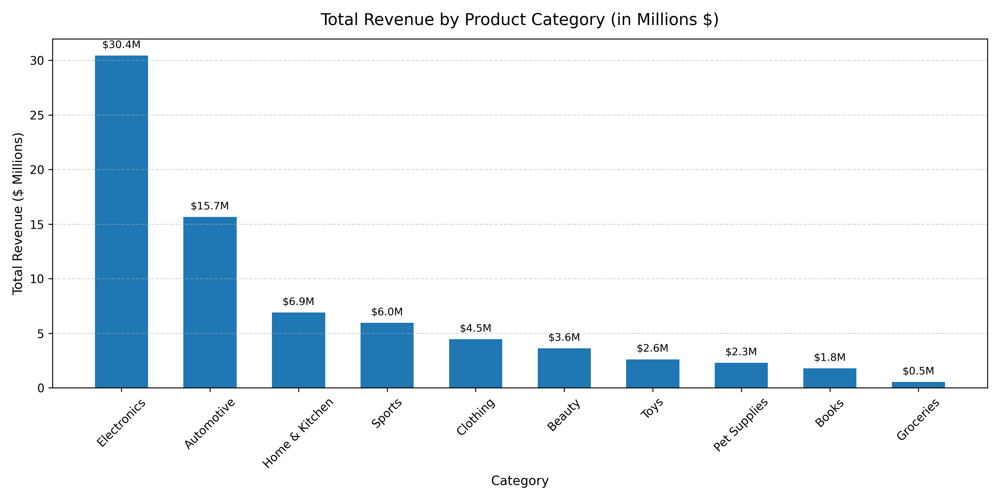
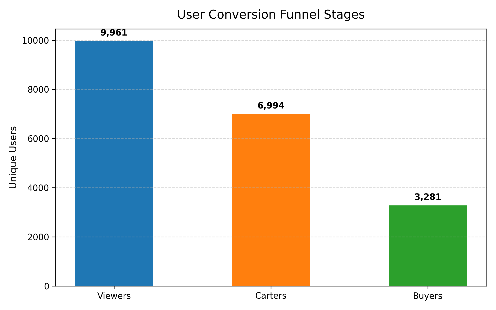
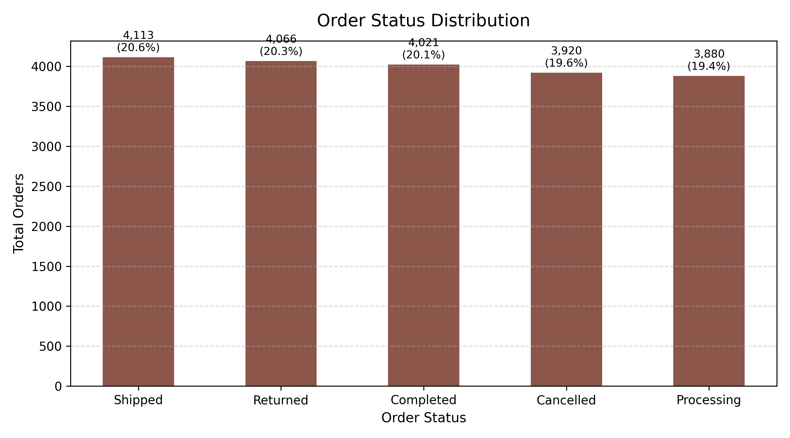
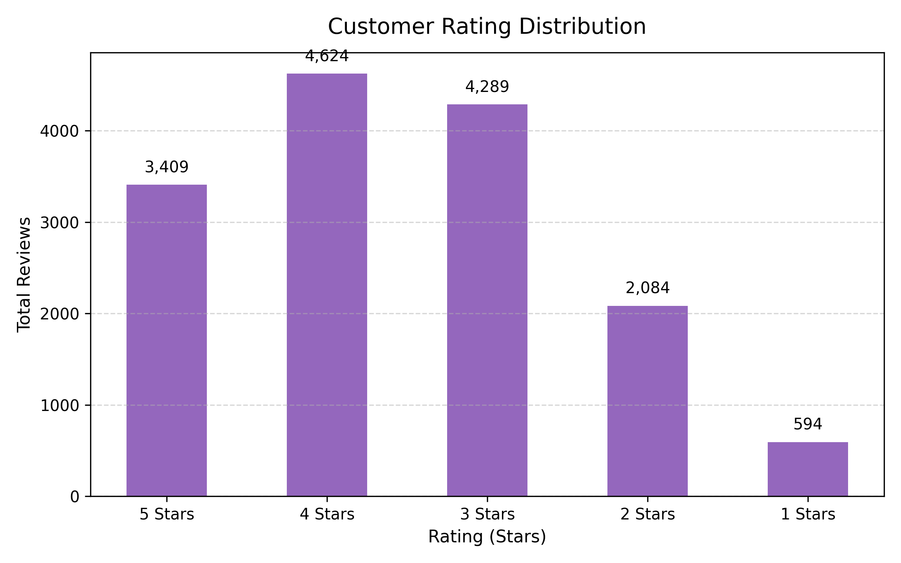

# ecommerce-sales-customer-analytics-python
E-commerce transactional sales data analysis  using Python and Pandas.
# E-Commerce Data Analysis & Business Intelligence Pipeline (Python / SQL / Colab)

## Executive Summary
This project delivers a full-stack Exploratory Data Analysis (EDA) and Business Intelligence assessment on an enterprise transactional e-commerce dataset spanning **January 2024 through November 2025**. By analyzing customer behavior across seven core relational entities (sales, products, user events, ratings, categories, fulfillment, and geography), this project identifies primary revenue drivers, operational friction points, conversion funnel leakages, and geographic expansion opportunities.

---

## Key Performance Indicators (KPI Overview)

| Metric | Value | Business Impact |
| :--- | :--- | :--- |
| **Total Electronics Revenue** | **$30.43M+** | Leading revenue-generating category (39.2% share) |
| **Funnel Conversion Rate** | **32.94%** | View-to-Purchase conversion across 9,961 unique users |
| **Combined Friction Rate** | **39.93%** | Operational revenue loss from Cancellations & Returns |
| **Top Product Revenue** | **$858,086** | Generated by *Willow Hospital* (#1 grossing product) |

---

## Technical Architecture & Tools
* **Environment:** Google Colab / Jupyter Notebook
* **Database Engine:** SQLite 3 (`ecommerce.db`)
* **Languages:** Python 3.x & SQL
* **Data Libraries:** `pandas`, `numpy`, `matplotlib`, `seaborn`
* **Dataset:** E-Commerce Transactional Database (Jan 2024 – Nov 2025)

---

## Key Insights & Visualizations

### 1. Product Category Revenue Breakdown
Electronics and Automotive dominate gross revenue performance, jointly contributing **~60% of total revenue ($46.09M+)**, while sales volumes for lower-ticket items like Toys and Pet Supplies remain distributed. Average customer ratings remain strictly uniform across categories (**3.53 to 3.59 stars**), indicating system-wide product quality and fulfillment standards rather than category-specific failures.



#### Category Performance Table
| Category | Products | Units Sold | Total Revenue ($) | Avg Rating | Revenue Share (%) |
| :--- | :--- | :--- | :--- | :--- | :--- |
| **Electronics** | 203 | 35,900 | $30,439,067.72 | 3.56 | 39.2% |
| **Automotive** | 193 | 36,002 | $15,652,887.63 | 3.53 | 20.2% |
| **Home & Kitchen** | 199 | 36,045 | $6,900,475.43 | 3.54 | 8.9% |
| **Sports** | 183 | 35,670 | $5,956,274.42 | 3.53 | 7.7% |
| **Clothing** | 213 | 40,299 | $4,463,526.55 | 3.56 | 5.8% |
| **Beauty** | 207 | 41,690 | $3,622,282.98 | 3.57 | 4.7% |
| **Toys** | 213 | 43,570 | $2,608,012.50 | 3.55 | 3.4% |
| **Pet Supplies** | 212 | 43,021 | $2,284,032.69 | 3.59 | 2.9% |
| **Books** | 194 | 38,713 | $1,783,863.40 | 3.54 | 2.3% |
| **Groceries** | 183 | 32,891 | $540,396.51 | 3.54 | 0.7% |

---

### 2. User Conversion Funnel & Drop-Off Dynamics
Out of 9,961 unique product viewers, **70.21% (6,994 users)** proceed to add products to their carts. However, **53.09% of cart adders abandon their purchase** prior to checkout completion, leaving **3,281 completed buyers** (32.94% overall conversion).



#### Funnel Stages
| Stage | Unique Users | Conversion Rate | Stage Diagnosis |
| :--- | :--- | :--- | :--- |
| **1. Product Viewers** | 9,961 | 100.0% | Baseline engagement |
| **2. Cart Additions** | 6,994 | 70.21% | High buyer intent |
| **3. Completed Buyers** | 3,281 | 46.91% | Cart-to-purchase completion |

---

### 3. Order Fulfillment & Operational Friction
Operational status tracking across all orders reveals substantial revenue leaks. **Returned orders (20.33% / $24.27M)** and **Cancelled orders (19.60% / $22.99M)** account for a combined **39.93% operational friction rate**, severely reducing net margins.



#### Order Status Breakdown
| Status | Total Orders | Percentage Share | Total Order Value ($) |
| :--- | :--- | :--- | :--- |
| **Shipped** | 4,113 | 20.57% | $24,238,665.56 |
| **Returned** | 4,066 | 20.33% | $24,269,180.02 |
| **Completed** | 4,021 | 20.11% | $24,197,125.58 |
| **Cancelled** | 3,920 | 19.60% | $22,987,000.13 |
| **Processing** | 3,880 | 19.40% | $23,494,716.66 |

---

### 4. Customer Rating & Sentiment Distribution
Review metrics indicate strong core satisfaction, with **53.56% of reviews rated 4 or 5 stars**. However, **17.85% (2,678 reviews)** represent negative sentiment (1 and 2 stars), pointing to specific fulfillment or product description mismatches.



---

### 5. Top Revenue-Generating Products

| Product Name | Gross Revenue ($) | Market Rank |
| :--- | :--- | :--- |
| **Willow Hospital** | **$858,086.00** | #1 Revenue Leader |
| **Pulse Security** | **$585,154.00** | #2 Top Performer |
| **Pulse Treat** | **$530,424.00** | #3 Top Performer |
| **GreenLeaf System** | **$529,486.00** | #4 Key Revenue Driver |
| **GreenLeaf Item** | **$446,018.00** | #5 Key Revenue Driver |

---

## Strategic Recommendations
1. **Recapture Cart Abandonment (53% Drop-Off):** Implement abandoned-cart email sequences, transparent shipping cost displays, and guest checkout options to capture intent.
2. **Mitigate Operational Friction (40% Returns/Cancellations):** Audit logistics SLAs and product listing specs to cut return rates from 20% down toward industry standards (10–15%).
3. **Target High-AOV Regional Markets:** Prioritize ad spending toward high Average Order Value (AOV) cities such as *New Nathaniel ($619.01 AOV)* and *East Beth ($464.02 AOV)*.

---

## Repository Structure
```text
├── ecommerce_eda_analysis.ipynb              # Jupyter/Colab notebook with complete script
├── E-Commerce Exploratory Data Analysis Report.pdf # Executive PDF analytics report
├── category_performance.png                   # Category revenue chart
├── user_conversion_funnel.png                # Conversion funnel chart
├── order_status_distribution.png             # Order fulfillment status chart
├── customer_ratings_distribution.png         # Customer sentiment chart
├── category_performance.csv                  # Exported CSV result tables
├── customer_ratings_distribution.csv         # Exported rating CSV tables
└── README.md                                 # Project documentation
